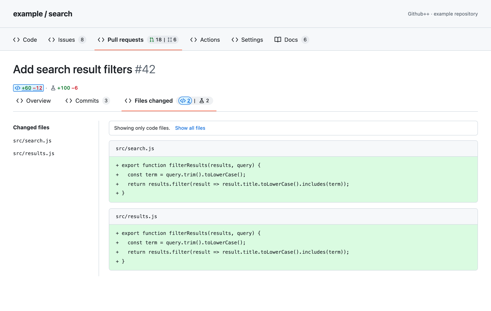
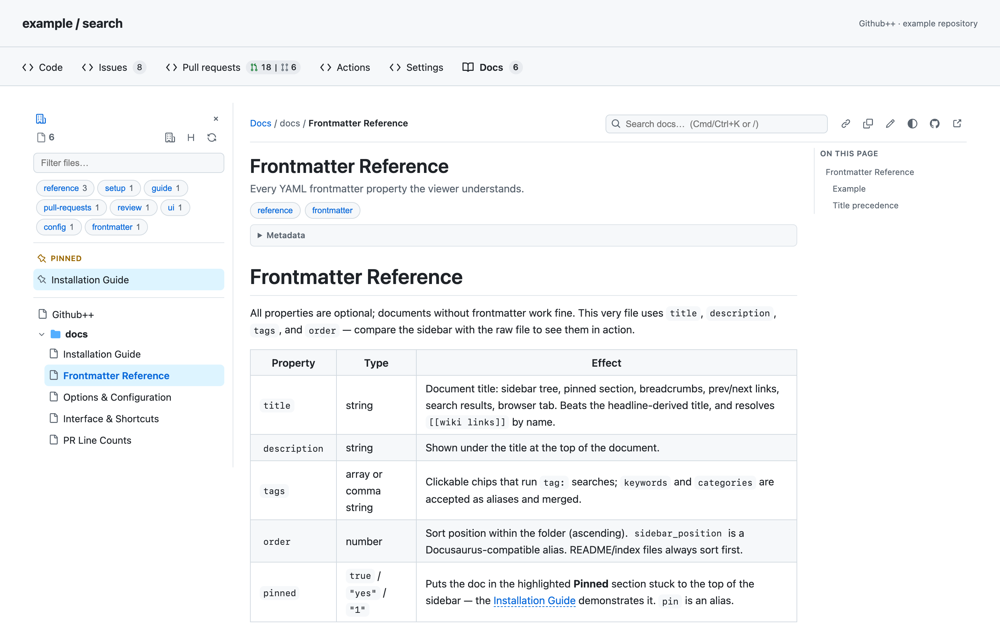

# Github++

A browser extension for GitHub. Read repository docs and separate code changes from test changes.

## Pull requests

- See separate line counts and file counts for code and tests.
- Select a count to show only code files or test files.
- Select the active count again to show all files.
- Open separate lists for ready PRs and draft PRs from the repository tab.

Tests include fixtures, snapshots, mocks, and test runner configuration. The extension uses file names and paths to classify files.



## Documentation

The **Docs** tab shows Markdown files with a file tree, search, and a table of contents.
Press **Cmd+K** or **Ctrl+K** from any repository page to open the floating documentation search palette. Choose a result to open it in Docs; press Escape to return to your page.
You can change the tab position in **Options**.

[Confluence Cloud](docs/confluence.md) pages appear in their own site and space groups. Connect a site using your browser login, read pages in Docs, and attach them to repository groups. Attachments are personal settings saved in your browser.



*Screenshots use example data and the actual extension. You can reproduce them without an account.*

## Download a build

Download the Chrome or Firefox ZIP from the [latest release](https://github.com/fwin-git/github-plus-plus/releases/latest) and unzip it.

- **Chrome, Edge, Brave:** open `chrome://extensions`, enable Developer mode, select **Load unpacked**, and choose the unzipped folder.
- **Firefox, Zen:** open `about:debugging#/runtime/this-firefox`, select **Load Temporary Add-on…**, and choose `manifest.json` from the unzipped folder. This unsigned development build lasts until the browser closes.

For an update, load the new build and refresh your GitHub tabs.

## Install from source

Requires Node.js 22.12 or later.

```sh
git clone https://github.com/fwin-git/github-plus-plus.git
cd github-plus-plus
npm ci
npm run build
```

### Firefox and Zen

1. Open `about:debugging#/runtime/this-firefox`.
2. Select **Load Temporary Add-on…**.
3. Select `dist-firefox/manifest.json`.

The browser removes this temporary installation when it closes. A permanent Firefox installation requires a signed extension. See [Firefox installation details](https://extensionworkshop.com/documentation/develop/temporary-installation-in-firefox/).

### Chrome, Edge, and Brave

1. Open your browser's extensions page, such as `chrome://extensions`.
2. Enable **Developer mode**.
3. Select **Load unpacked**.
4. Select the `dist` folder.

After a new build, reload the extension on the extensions page. Then reload GitHub.

## Private repositories

Open the extension's **Options** page to save a GitHub token.
For reading private repositories, use a token with **Contents: read** and **Pull requests: read** access to those repositories.
Your organization may require approval or SSO authorization.

The extension stores settings, tokens, cached docs, and drafts in your browser.
It sends API requests directly to GitHub and any Confluence sites you connect. Confluence access requires permission for each site and uses your existing browser login. Personal attachments stay in local extension storage; Confluence page bodies are not persisted. It has no analytics service.
Images in documents can load from their source URLs.

## Documentation for agents

Point your agent to [skills/github-plus-plus-docs/SKILL.md](skills/github-plus-plus-docs/SKILL.md).
The skill explains the folder structure, Markdown format, metadata, and links that Github++ supports.

Example instruction:

> Use the Github++ docs skill to check this repository's docs. Correct compatibility problems and preserve existing content.

See [all guides](docs/README.md) for search, editing, settings, and other features.

## Limits

- Supports `github.com`. GitHub Enterprise domains are not supported.
- File classification uses naming conventions. It can classify unusual names incorrectly.
- If counts are incomplete or do not match, the extension keeps GitHub's original counts.
- Mermaid and math blocks appear as source. MDX components do not run.

## Development

```sh
npm test
npm run test:browser
npm run build
npm run media
```

Browser tests and screenshots use local example data. See [the development guide](docs/development.md) for details.
